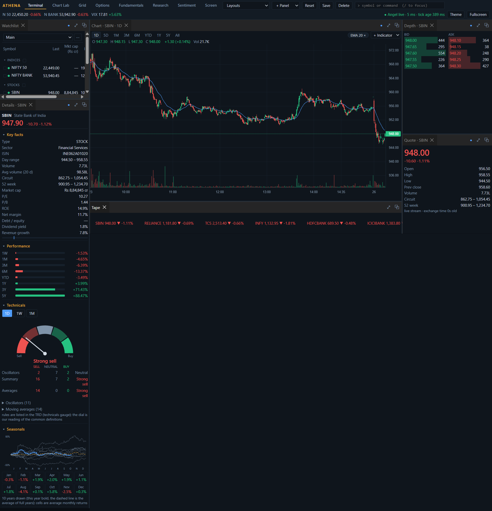
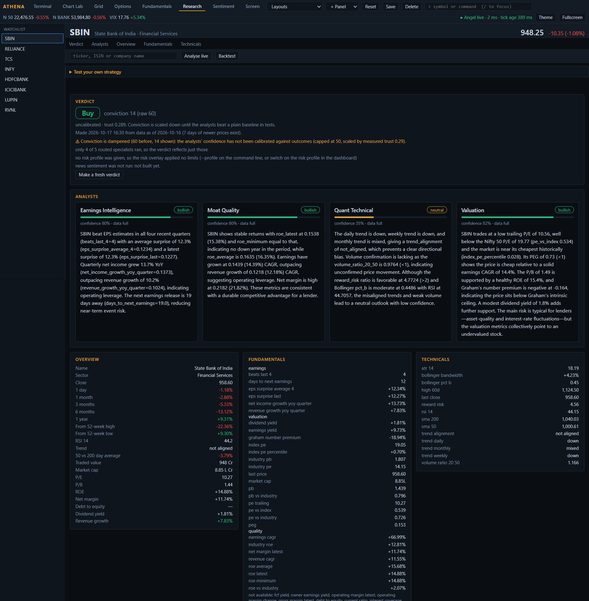
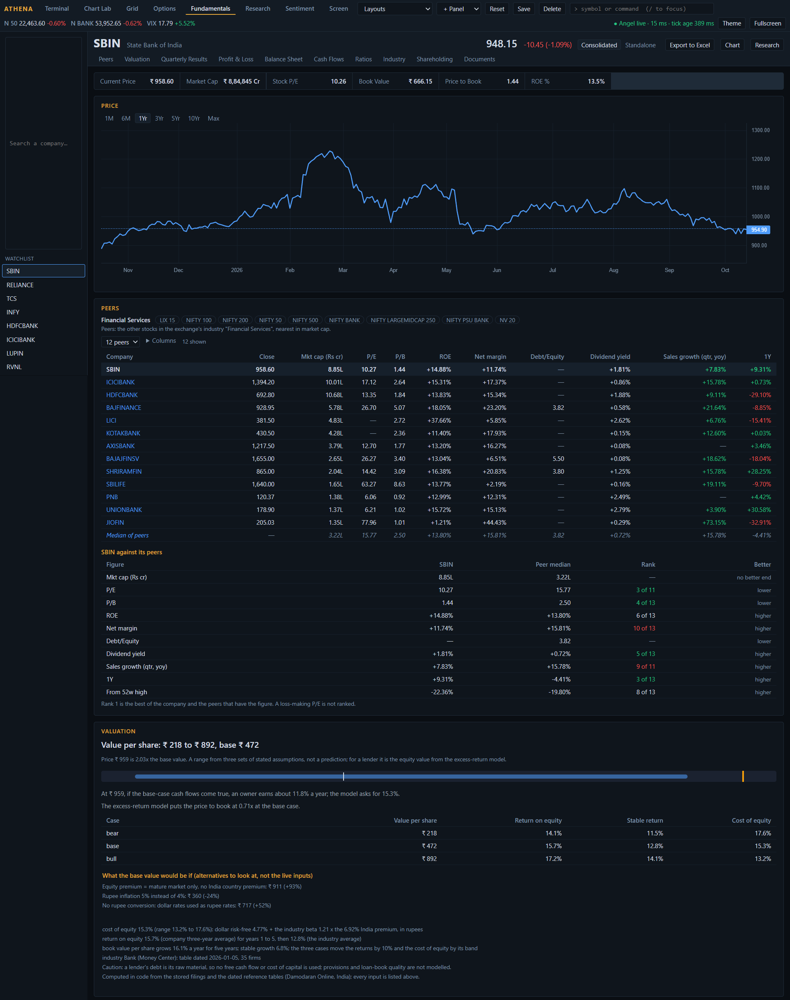
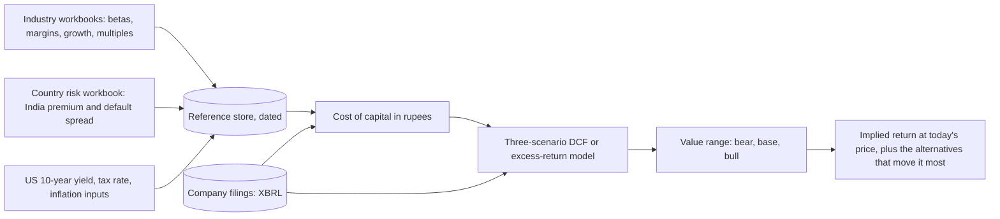
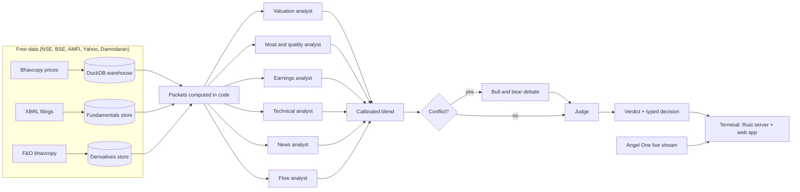

# Athena: open-source AI fund manager and stock research terminal for the Indian stock market (NSE)

[](LICENSE)


**Athena is a self-hosted, multi-agent AI research desk for Indian equities and ETFs.** A team of specialist LLM analysts (valuation, moat and quality, earnings, technicals, news, derivatives flow) reads figures that are computed in code from free NSE data. A council debates any disagreement, and a judge writes one dated, auditable verdict. The verdicts show up in a fast, Bloomberg-style trading terminal with live prices, an options chain with Greeks, charts, a fundamentals page and a stock screener.

It is built for one independent investor who wants an institutional-style research process at home. It is **not** investment advice, it places **no** orders, and it has **not** yet been shown to beat the market. See [Honest status](#honest-status).



### Why Athena is different

- **Code computes, models interpret.** Every ratio, growth rate and valuation is arithmetic done in code. The language models only read the results, and a check rejects any number they cite that is not in the data.
- **Valuation on Aswath Damodaran's method.** Cost of capital, industry benchmarks, country risk, distress and option dilution follow his published workbooks, and every input is listed on the page. See [Built on Damodaran's valuation method](#built-on-damodarans-valuation-method).
- **Free data only.** NSE and BSE archives, the exchange's XBRL filings, AMFI, Yahoo Finance and Damodaran's datasets. No paid data vendor. See [Free data only](#free-data-only-no-paid-vendors).
- **Negative results are published.** The analysts, a time-series forecasting model and 21 valuation rules were tested against plain baselines. None showed reliable skill, so conviction is capped. See [What we tested, and what did not work](#what-we-tested-and-what-did-not-work).
- **Built like production software.** More than 4,600 offline tests across Python, Rust and TypeScript, point-in-time data so nothing from the future leaks in, and a CI gate that pins the test counts.

## Screenshots

Captured from a running terminal on 26 October 2026 with live Angel One prices. Nothing is mocked.

**Research.** The stored verdict with one card per analyst, each quoting the figures it used. The top screenshot above is the live terminal: chart with indicators, order-book depth, quote, tape, technicals gauge and ten-year seasonality.



**Fundamentals and valuation.** Peers ranked against the stock, then a value *range* (bear, base, bull) with the return the market price implies and the alternatives that move the answer most.



The verdict in the Research screenshot says "conviction 14 (raw 60)" on purpose: the analysts have not yet beaten a plain baseline in tests, so the conviction shown is scaled down by their measured trust. That is the design working, not a bug.

---

## Contents

- [What Athena does](#what-athena-does)
- [Built on Damodaran's valuation method](#built-on-damodarans-valuation-method)
- [Free data only, no paid vendors](#free-data-only-no-paid-vendors)
- [What we tested, and what did not work](#what-we-tested-and-what-did-not-work)
- [How it works](#how-it-works)
- [Design principles](#design-principles)
- [Quick start](#quick-start)
- [Configuration](#configuration)
- [Project layout](#project-layout)
- [Testing](#testing)
- [Honest status](#honest-status)
- [FAQ](#faq)
- [Disclaimer](#disclaimer)
- [License](#license)

---

## What Athena does

### AI stock analysis with specialist agents
- **Six specialist analysts:** valuation, moat and quality, earnings intelligence, quant and technical, news sentiment, and derivatives flow. Each reads a *packet* of figures computed in code and must cite the figures it uses. A numeric consistency check rejects any number in its reasoning that is not somewhere in its data; it does not bind a figure to a metric, period, entity or sign, and its output says so (`verification.binds_claims: false`). An opt-in typed contract (`Specialist(claims=True)`) has the model state each figure as a claim naming the fact, entity, metric, period, signed value and unit, which code checks and renders; the model's own words carry no figures and stay labelled as unreviewed interpretation.
- **Coverage-aware:** an analyst abstains when its data is too thin. It never guesses.
- **Council:** when the analysts conflict, a bull and a bear argue over a shared evidence sheet with stable fact IDs. A judge may then move the blended rating by at most one step, and may only lower its conviction.
- **Typed decisions:** every verdict becomes BUY, SELL, HOLD or REVIEW by written rules. It is later settled against the Nifty 50 at 5, 20 and 60 trading days, after trading costs.

### Fundamentals from exchange filings
- **Statements from the exchange's own XBRL filings:** quarterly and annual income statement, balance sheet and cash flow for about 2,300 NSE companies. Shareholding patterns and filing documents are stored alongside.
- **Valuation model:** a written-rule discounted cash flow gives a value *range* (low, base, high), never a target price. It comes with cost of capital, implied versus required return, sensitivities, and a comparison with the typical company's price-to-value ratio.
- **Industry context:** each company is compared with industry benchmarks taken from Aswath Damodaran's published datasets.

### Trading terminal (Rust and TypeScript)
- **Live prices:** a push stream from Angel One SmartAPI for up to 600 symbols, with the exchange snapshot as fallback, delivered to the page in milliseconds.
- **Options chain:** live futures and options quotes pushed as they change, with implied volatility, Greeks (Black-76), the volatility smile, ATM volatility by expiry, max pain, put-call ratio and a payoff builder.
- **Charts:** daily split-adjusted history since 2010, and intraday bars that the server completes from the live stream so there is no gap and live volume is included. Indicators, a formula language, drawings, chart grids and replay.
- **Screener and research:** a market screen over about 2,700 symbols, a heatmap, an earnings calendar, peers, the fundamentals page with an Excel export, and the research page with stored verdicts.

### Research and evaluation tooling
- **Point-in-time warehouse:** DuckDB holding 7.7 million daily price rows (2010 onward), corporate actions, symbol renames, index levels, and precomputed analyst packets.
- **Walk-forward tests:** momentum, reversal and low-volatility tests with costs applied, so any analyst has a base rate to beat. The analysts are also scored on their hit rate, information coefficient and settled excess return.
- **Derivatives flow:** five years of F&O bhavcopy. Long or short build-up, short covering, open-interest spikes, put-call shifts and max-pain drift are scored against each stock's own history.
- **Document search:** BM25 plus optional embeddings with a published-by-date filter. A red-flag review keeps a finding only if its quote is really in the cited passage.

---

## Built on Damodaran's valuation method

Athena's valuation does not use a black box or a model's opinion. It follows the published method and workbooks of [Aswath Damodaran](https://pages.stern.nyu.edu/~adamodar/) (NYU Stern), step by step, in code that is tested against his own spreadsheets. All credit for the method is his. Athena applies it to Indian companies and shows its working.



| Step | What the code does | Where |
| --- | --- | --- |
| **Industry benchmarks** | Reads his India industry workbooks (the "Industry Averages" sheet) and uses his aggregates, such as industry market value over total earnings, not the average of company P/Es. A figure outside what a multiple can sensibly be is set aside and flagged. | `src/athena/reference/damodaran.py`, `src/athena/valuation/industry.py` |
| **Country risk** | Loads his country-risk workbook (equity risk premium, country risk premium, default spread). Each revision is kept under its own date, and a valuation for a past date reads the newest one published on or before it. | `src/athena/reference/country.py` |
| **Cost of capital** | His steps, worked in dollars and turned into rupees with the two inflation rates: risk-free rate (US 10-year yield less the US default spread), equity premium (mature market plus India), the industry's unlevered beta corrected for cash and relevered at the company's own debt to equity, and cost of debt from a synthetic rating based on interest cover. A low and a high case move every driver by its band. | `src/athena/valuation/wacc.py`, `capital.py`, `ratings.py` |
| **Cash-flow model** | A ten-year free-cash-flow-to-the-firm valuation in the shape of his `fcffsimpleginzu.xlsx`. A golden test feeds the workbook's sample company through the code and checks each of the ten years. | `src/athena/valuation/dcf.py` |
| **Distress and options** | Blends the going-concern value with a failure value using his default-rate tables, and values employee options the way his `employeeoption.xls` does. Both are written inputs shown on the page, not forecasts. | `distress.py`, `dilution.py` |
| **Banks and lenders** | Valued by the excess-return model on equity, because a lender's debt is raw material and free cash flow means nothing for it. | `scenarios.py` |
| **Sensitivities** | Shows what the base value would be with the India premium left out, with rupee inflation one point higher, and with no rupee conversion, so a reader sees what each assumption is worth. | `sensitivity.py` |

**Two safeguards stand on top of it.**
- **No silent defaults.** A figure the filings or the reference store do not hold is listed as missing and no value is given. The only defaults are dated inputs you can read and change (`python -m athena.reference input`).
- **A cross-check against his tables.** Athena builds its own industry tables from the NSE filings as they stood on a given day, in the same way his aggregates are built, and writes a divergence report against his India tables (`python -m athena.valuation own-divergence`). Nothing switches over to Athena's own tables automatically; the report is for the owner to read first.

**Using his data.** Athena does not ship his workbooks. Download the India industry workbooks and the country-risk workbook from his site into `.athena/damodaran`, then run `python -m athena.reference load` and `python -m athena.reference audit`. Without them, the valuation page says what is missing rather than guessing.

---

## Free data only, no paid vendors

Athena runs on public data. The only cost is the optional language-model calls, and free tiers (NVIDIA NIM, OpenRouter) work.

| Source | What it feeds |
| --- | --- |
| NSE daily archive files (bhavcopy) | Raw prices for about 2,700 symbols from 2010 in the DuckDB warehouse, adjusted for splits and bonuses by Athena's own corporate-action code. |
| NSE F&O bhavcopy | Five years of futures and options history for the derivatives-flow analyst and the options views. |
| Exchange XBRL filings | Quarterly and annual income statement, balance sheet and cash flow for about 2,300 companies, plus shareholding patterns and filing documents. |
| NSE index files and corporate actions | Index levels and P/E, the event calendar, symbol renames and the price-adjustment events. |
| Damodaran's datasets | Industry benchmarks and country risk for the valuation (see above). |
| Yahoo Finance | Intraday bars. |
| US 10-year Treasury yield | The risk-free input for the cost of capital (`python -m athena.reference rates`). |
| Angel One SmartAPI | The live price and options stream, read-only. A free Angel One account is enough. |

Every dataset carries an as-of date and a coverage label. A stale dataset produces a refusal rather than a quiet guess, and an analyst abstains when its data is too thin.

---

## What we tested, and what did not work

Most AI-trading projects show only the wins. Athena measures every claim against a plain baseline, and these are the results so far. The analyst figures are read from the calibration file the verdicts use.

**Analysts against "give the same answer every time".** Each analyst's accuracy at 63, 126 and 252 trading days, against the best single answer given for every case:

| Analyst | Cases (63 / 126 / 252 d) | Accuracy at 63 / 126 / 252 d | Best fixed answer |
| --- | --- | --- | --- |
| Earnings intelligence | 612 / 564 / 564 | 38.6% / 33.2% / 32.3% | 39.2% / 37.8% / 38.5% |
| Moat and quality | 740 / 620 / 580 | 33.4% / 33.1% / 39.3% | 40.0% / 40.2% / 38.1% |
| Quant and technical | 1,269 at 63 d | 30.6% at 63 d | 35.2% at 63 d |

Only one cell edges above its baseline (moat and quality at 252 days, 39.3% against 38.1%). The rest are at or below it.

| Test | Result | What we did about it |
| --- | --- | --- |
| Technical analyst on stored prices (40 stocks, blind, 2,400 runs) | 30 / 32 / 33% against about 35% for the best fixed answer. It never says bullish. | Treated like the other analysts: its conviction is scaled by measured trust. |
| **Kronos-small**, a time-series forecasting model | 35 / 34% against 39%. Rank correlation with later returns is about zero (+0.001 at 63 days, -0.084 at 126). | Kept out of the verdicts. |
| **21 valuation rule variants**, point-in-time, seven dates from December 2022 to December 2025 | None, not even plain earnings yield or book-to-price, ranks later returns reliably (rank correlation about +0.02 at six months). The median price is about 2.3 times the model's base value. | Rules are chosen on first principles and shown as ranges. They are never tuned to close the gap with the price. |
| **14 forensic accounting measures**, two start dates | Weak and inconclusive. A pre-registered cash-flow composite was not replicated at the second date. | Weights and bands are not tuned. The one clean test left is a forward log, first snapshot taken on 6 November 2026 and not gradable before 6 November 2027. |

**What the design does about it.**
- Conviction is capped at 50 and scaled by each analyst's measured trust, so a raw 60 is shown as 14 until the analysts beat a baseline in tests.
- The council runs beside the blended verdict and is promoted only if it beats the blend on settled outcomes.
- Values are ranges, and the page shows the return the market price implies, so a reader can disagree with the model on its own terms.
- Samples are small and the periods overlap. Read these as "no evidence of skill yet", not as proof that none exists.

---

## How it works



- **Data layer (Python):** loaders for NSE bhavcopy, XBRL filings, index files, F&O bhavcopy and the Damodaran datasets, written into DuckDB. Every dataset carries an as-of date and a coverage label.
- **Analysts (Python):** each analyst is a persona prompt plus a schema. The figures it reads are computed in code beforehand, and the model only interprets them. A router sends each call through tiers of OpenAI-compatible providers (NVIDIA NIM, OpenRouter, OpenAI), with a monthly call ceiling and a reply cache.
- **Terminal (Rust):** an `axum` server on `127.0.0.1` holds the live quote hub and pushes changes over a WebSocket. It serves the stored analysis and answers the Fundamentals and valuation pages through warm Python helpers.
- **Web app (TypeScript):** charts, options, screener, fundamentals and research views, built with Vite and tested with Vitest.

---

## Design principles

- **The model never does arithmetic.** Every ratio, growth rate, valuation and z-score is computed in code. The model interprets; it does not calculate.
- **Ranges, not points.** Values are given as low, base and high, and conviction is capped until it is calibrated against outcomes.
- **Point-in-time honesty.** A backtest or verdict only sees data published by its as-of date, so nothing from the future leaks in.
- **Honest coverage.** Missing data is named, and a stale dataset produces a refusal rather than a quiet guess.
- **Research never places orders.** Verdicts and the live stream are read-only. An optional broker desk exists, but it is off by default, paper trading comes first, and a real order needs limits you write by hand and a confirmation typed at a console.
- **Generic fixes.** A defect is fixed for every symbol, never patched for one ticker.

---

## Quick start

Requirements:
- **Python** 3.11 or newer.
- **Rust**: a stable toolchain.
- **Node.js** 20 or newer.
- **TA-Lib**: the C library that the Python `TA-Lib` package needs.

Development and testing have been on Windows 11. The Python and Rust parts are cross-platform, but the helper scripts are PowerShell.

```powershell
git clone https://github.com/maahin-1/athena-the-fund-manager.git
cd athena-the-fund-manager

# Python package and tests
python -m venv .venv
.venv\Scripts\activate
pip install -e ".[dev]"
python -m pytest -q

# Settings: copy the template and fill in only the keys you need
copy .env.example .env

# Build the market warehouse: prices, corporate actions, indices, packets (hours on first run)
python -m athena.warehouse.build --since 2024-01-01

# Analyse one stock from the command line
python -m athena.cli SBIN

# Start the terminal at http://127.0.0.1:8700
scripts\terminal.ps1          # live prices (needs Angel One settings)
scripts\terminal.ps1 -Fake    # deterministic fake prices, no broker needed
```

**The data keeps itself fresh while the terminal is open.** Starting the terminal also starts one background supervisor (`athena.ops.supervisor`) that runs each data job when it is due: prices, derivatives, the event calendar, index membership, statements, shareholding, documents, annual-report history, the valuation snapshot and the health checks. One job runs at a time, a job that fails or is refused waits and tries again, and everything stops when the terminal closes. Nothing is registered with the operating system. `python -m athena.ops.supervisor --list` shows when each job last ran; `.athena/jobs.json` switches a job off or changes its gap; `terminal --no-jobs` turns the supervisor off. Without the terminal, `python -m athena.ops.supervisor` does the same.

**Brokers.** Paper trading is the default. Real orders work through Groww, Zerodha, Angel One, ICICI Direct and Upstox behind one desk with limits, a kill switch, a signed audit log and a confirmation typed at a console; none has been tried with a real account yet. See [docs/brokers/README.md](docs/brokers/README.md).

The older Streamlit dashboard also still runs:

```powershell
python -m athena.dashboard
```

---

## Configuration

All settings live in `.env`; [`.env.example`](.env.example) lists every key and says what needs it. Leave a key blank to switch off the feature that uses it. The offline test suite needs no keys at all.

| Key | Needed for |
| --- | --- |
| `NVIDIA_API_KEY`, `OPENROUTER_API_KEY`, `OPENAI_API_KEY` | The LLM analysts and the judge (at least one is needed). |
| `ANGEL_API_KEY`, `ANGEL_CLIENT_CODE`, `ANGEL_PIN`, `ANGEL_TOTP_SECRET` | The live price and options stream (read-only). |
| `KITE_API_KEY` and related keys | Optional Zerodha connection. |
| `FRED_API_KEY`, `HF_TOKEN` | Optional extras. |

Market data comes from free public sources: NSE and BSE archives, the exchange's XBRL filings, AMFI, Yahoo Finance and Damodaran's datasets. No paid data vendor is used.

---

## Project layout

| Path | What it holds |
| --- | --- |
| `src/athena/agents` | Analyst personas, schemas and the grounding checks. |
| `src/athena/council` | Evidence sheet, bull and bear debate, and the judge. |
| `src/athena/verdicts` | Verdict runner, typed decisions and settlement. |
| `src/athena/warehouse` | DuckDB market warehouse, the build, packets and the screen. |
| `src/athena/fundamentals` | XBRL ingest, statements, shareholding, documents and annual-report extraction. |
| `src/athena/valuation` | Discounted cash flow, cost of capital, scenarios and calibration. |
| `src/athena/derivs`, `src/athena/flow` | F&O history and the flow detectors. |
| `src/athena/retrieval` | Document search and red-flag review. |
| `src/athena/evaluation` | Scorecard, walk-forward tests and golden cases. |
| `src/athena/llm` | Provider router, call budget and reply cache. |
| `terminal/src` | Rust server: live quote hub, Angel One stream and API. |
| `terminal/web` | TypeScript web terminal. |
| `PRD.md`, `TRD.md` | Product requirements and the technical record of every design decision. |

---

## Testing

```powershell
python -m pytest -q                      # about 3,200 Python tests
cd terminal; cargo test                  # about 420 Rust tests
cd terminal\web; npx vitest run          # about 1,060 web tests
```

The tests run offline against fixtures, so they need no network access and no keys. A CI gate pins the exact Python and Rust counts (`ci/expected-counts.json`), so a test cannot be dropped without the change being explained. The Damodaran golden tests need his workbooks and are skipped when they are absent.

---

## Honest status

Athena is a working research tool, still at the research stage.

- **Not yet shown to beat the market:** on the verdicts and logs held so far, no analyst has shown statistically meaningful skill against a plain baseline. That is why conviction is capped and damped until calibration says otherwise. The numbers are in [What we tested, and what did not work](#what-we-tested-and-what-did-not-work).
- **Council on trial:** the council runs beside the blended verdict and does not replace it. It will only be promoted if it beats the blend on settled outcomes.
- **Cost estimates unverified:** trading-cost rates follow the broker's published schedule. They still have to be checked against a real contract note.
- **Indian markets only:** coverage is Indian equities, ETFs and F&O. Bonds and mutual funds are planned.

---

## FAQ

### What is Athena?
Athena is an open-source, self-hosted AI fund manager and research terminal for the Indian stock market. Several specialist LLM agents analyse a stock from figures computed in code. A council resolves their disagreements, and the result is shown in a live trading terminal with charts, an options chain and a screener.

### Is Athena free?
Yes. The code is open source under the MIT licence and the market data comes from free public sources. The only costs are optional LLM API calls, and the free NVIDIA NIM and OpenRouter tiers work.

### Does Athena trade automatically or place orders?
No. Athena produces research verdicts and its live connection only reads market data. An optional broker desk exists but is off by default (paper trading first, hand-written limits, a confirmation typed at a console), and none of its adapters has been tried with a real account yet. See [docs/brokers/README.md](docs/brokers/README.md).

### Which markets and instruments does it cover?
NSE-listed stocks and ETFs, plus index and stock futures and options (NFO) for the derivatives views. Bonds and mutual funds are on the roadmap.

### Which AI models does it use?
Any OpenAI-compatible provider. By default it uses NVIDIA NIM and OpenRouter models, with OpenAI as an option, routed by tier: cheap, mid, strong and judge. A monthly call ceiling and a reply cache keep costs bounded.

### How is Athena different from other AI trading agent projects?
The models never compute figures; code does, and a numeric consistency check rejects any number that is not in the data (a number that is in the data but attached to the wrong metric is caught only under the typed-claims contract). Every analysis respects the as-of date, so backtests see no future data. Each verdict is turned into a typed decision and settled after costs against the Nifty 50. And it ships a full live terminal, not just a notebook.

### Can I use it for US or other stocks?
Not yet. The loaders, calendars and filings are specific to NSE. The agent and council layers are market-agnostic, but other markets would need their own data loaders.

### Is this investment advice?
No. See the disclaimer below.

---

## Disclaimer

Athena is a personal research and educational project. It is **not** investment advice, a recommendation, or an offer to buy or sell any security. The author is not a SEBI-registered investment adviser or research analyst. Market data may be delayed, incomplete or wrong, and model output can be mistaken. Do your own research and consult a registered professional before making investment decisions. You are solely responsible for any use of this software.

---

## License

Licensed under the [MIT License](LICENSE). Copyright (c) 2026 maahin-1. Versions published before the change to MIT were released under Apache-2.0, and a copy received then stays under those terms.

*Keywords: AI fund manager, AI stock analysis, LLM trading agents, multi-agent investment research, Indian stock market, NSE, Nifty 50, stock screener, options chain, Greeks, Bloomberg terminal alternative, Angel One SmartAPI, XBRL fundamentals, discounted cash flow valuation, DuckDB, Rust, TypeScript, open source.*
