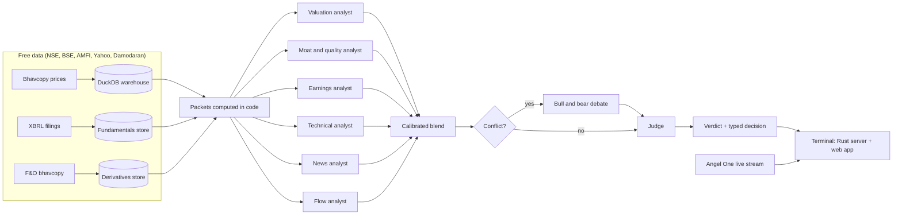

# Athena: open-source AI fund manager and stock research terminal for the Indian stock market (NSE)

[](LICENSE)


**Athena is a self-hosted, multi-agent AI research desk for Indian equities and ETFs.** A team of specialist LLM analysts (valuation, moat and quality, earnings, technicals, news, derivatives flow) reads figures that are computed in code from free NSE data. A council debates any disagreement, and a judge writes one dated, auditable verdict. The verdicts show up in a fast, Bloomberg-style trading terminal with live prices, an options chain with Greeks, charts, a fundamentals page and a stock screener.

It is built for one independent investor who wants an institutional-style research process at home. It is **not** investment advice, it places **no** orders, and it has **not** yet been shown to beat the market. See [Honest status](#honest-status).

---

## Contents

- [What Athena does](#what-athena-does)
- [How it works](#how-it-works)
- [Design principles](#design-principles)
- [Quick start](#quick-start)
- [Configuration](#configuration)
- [Project layout](#project-layout)
- [Testing](#testing)
- [Honest status](#honest-status)
- [FAQ](#faq)
- [Disclaimer](#disclaimer)
- [License](#license)

---

## What Athena does

### AI stock analysis with specialist agents
- **Six specialist analysts:** valuation, moat and quality, earnings intelligence, quant and technical, news sentiment, and derivatives flow. Each reads a *packet* of figures computed in code and must cite the figures it uses. A grounding check rejects any number in its reasoning that is not in its data.
- **Coverage-aware:** an analyst abstains when its data is too thin. It never guesses.
- **Council:** when the analysts conflict, a bull and a bear argue over a shared evidence sheet with stable fact IDs. A judge may then move the blended rating by at most one step, and may only lower its conviction.
- **Typed decisions:** every verdict becomes BUY, SELL, HOLD or REVIEW by written rules. It is later settled against the Nifty 50 at 5, 20 and 60 trading days, after trading costs.

### Fundamentals from exchange filings
- **Statements from the exchange's own XBRL filings:** quarterly and annual income statement, balance sheet and cash flow for about 2,300 NSE companies. Shareholding patterns and filing documents are stored alongside.
- **Valuation model:** a written-rule discounted cash flow gives a value *range* (low, base, high), never a target price. It comes with cost of capital, implied versus required return, sensitivities, and a comparison with the typical company's price-to-value ratio.
- **Industry context:** each company is compared with industry benchmarks taken from Aswath Damodaran's published datasets.

### Trading terminal (Rust and TypeScript)
- **Live prices:** a push stream from Angel One SmartAPI for up to 600 symbols, with the exchange snapshot as fallback, delivered to the page in milliseconds.
- **Options chain:** live futures and options quotes pushed as they change, with implied volatility, Greeks (Black-76), the volatility smile, ATM volatility by expiry, max pain, put-call ratio and a payoff builder.
- **Charts:** daily split-adjusted history since 2010, and intraday bars that the server completes from the live stream so there is no gap and live volume is included. Indicators, a formula language, drawings, chart grids and replay.
- **Screener and research:** a market screen over about 2,700 symbols, a heatmap, an earnings calendar, peers, the fundamentals page with an Excel export, and the research page with stored verdicts.

### Research and evaluation tooling
- **Point-in-time warehouse:** DuckDB holding 7.7 million daily price rows (2010 onward), corporate actions, symbol renames, index levels, and precomputed analyst packets.
- **Walk-forward tests:** momentum, reversal and low-volatility tests with costs applied, so any analyst has a base rate to beat. The analysts are also scored on their hit rate, information coefficient and settled excess return.
- **Derivatives flow:** five years of F&O bhavcopy. Long or short build-up, short covering, open-interest spikes, put-call shifts and max-pain drift are scored against each stock's own history.
- **Document search:** BM25 plus optional embeddings with a published-by-date filter. A red-flag review keeps a finding only if its quote is really in the cited passage.

---

## How it works



- **Data layer (Python):** loaders for NSE bhavcopy, XBRL filings, index files, F&O bhavcopy and the Damodaran datasets, written into DuckDB. Every dataset carries an as-of date and a coverage label.
- **Analysts (Python):** each analyst is a persona prompt plus a schema. The figures it reads are computed in code beforehand, and the model only interprets them. A router sends each call through tiers of OpenAI-compatible providers (NVIDIA NIM, OpenRouter, OpenAI), with a monthly call ceiling and a reply cache.
- **Terminal (Rust):** an `axum` server on `127.0.0.1` holds the live quote hub and pushes changes over a WebSocket. It serves the stored analysis and answers the Fundamentals and valuation pages through warm Python helpers.
- **Web app (TypeScript):** charts, options, screener, fundamentals and research views, built with Vite and tested with Vitest.

---

## Design principles

- **The model never does arithmetic.** Every ratio, growth rate, valuation and z-score is computed in code. The model interprets; it does not calculate.
- **Ranges, not points.** Values are given as low, base and high, and conviction is capped until it is calibrated against outcomes.
- **Point-in-time honesty.** A backtest or verdict only sees data published by its as-of date, so nothing from the future leaks in.
- **Honest coverage.** Missing data is named, and a stale dataset produces a refusal rather than a quiet guess.
- **No order placement.** The broker connection is read-only market data.
- **Generic fixes.** A defect is fixed for every symbol, never patched for one ticker.

---

## Quick start

Requirements:
- **Python** 3.11 or newer.
- **Rust**: a stable toolchain.
- **Node.js** 20 or newer.
- **TA-Lib**: the C library that the Python `TA-Lib` package needs.

Development and testing have been on Windows 11. The Python and Rust parts are cross-platform, but the helper scripts are PowerShell.

```powershell
git clone https://github.com/maahin-1/athena-the-fund-manager.git
cd athena-the-fund-manager

# Python package and tests
python -m venv .venv
.venv\Scripts\activate
pip install -e ".[dev]"
python -m pytest -q

# Settings: copy the template and fill in only the keys you need
copy .env.example .env

# Build the market warehouse: prices, corporate actions, indices, packets (hours on first run)
python -m athena.warehouse.build --since 2024-01-01

# Analyse one stock from the command line
python -m athena.cli SBIN

# Start the terminal at http://127.0.0.1:8700
scripts\terminal.ps1          # live prices (needs Angel One settings)
scripts\terminal.ps1 -Fake    # deterministic fake prices, no broker needed
```

The older Streamlit dashboard also still runs:

```powershell
python -m athena.dashboard
```

---

## Configuration

All settings live in `.env`; [`.env.example`](.env.example) lists every key and says what needs it. Leave a key blank to switch off the feature that uses it. The offline test suite needs no keys at all.

| Key | Needed for |
| --- | --- |
| `NVIDIA_API_KEY`, `OPENROUTER_API_KEY`, `OPENAI_API_KEY` | The LLM analysts and the judge (at least one is needed). |
| `ANGEL_API_KEY`, `ANGEL_CLIENT_CODE`, `ANGEL_PIN`, `ANGEL_TOTP_SECRET` | The live price and options stream (read-only). |
| `KITE_API_KEY` and related keys | Optional Zerodha connection. |
| `FRED_API_KEY`, `HF_TOKEN` | Optional extras. |

Market data comes from free public sources: NSE and BSE archives, the exchange's XBRL filings, AMFI, Yahoo Finance and Damodaran's datasets. No paid data vendor is used.

---

## Project layout

| Path | What it holds |
| --- | --- |
| `src/athena/agents` | Analyst personas, schemas and the grounding checks. |
| `src/athena/council` | Evidence sheet, bull and bear debate, and the judge. |
| `src/athena/verdicts` | Verdict runner, typed decisions and settlement. |
| `src/athena/warehouse` | DuckDB market warehouse, the build, packets and the screen. |
| `src/athena/fundamentals` | XBRL ingest, statements, shareholding, documents and annual-report extraction. |
| `src/athena/valuation` | Discounted cash flow, cost of capital, scenarios and calibration. |
| `src/athena/derivs`, `src/athena/flow` | F&O history and the flow detectors. |
| `src/athena/retrieval` | Document search and red-flag review. |
| `src/athena/evaluation` | Scorecard, walk-forward tests and golden cases. |
| `src/athena/llm` | Provider router, call budget and reply cache. |
| `terminal/src` | Rust server: live quote hub, Angel One stream and API. |
| `terminal/web` | TypeScript web terminal. |
| `PRD.md`, `TRD.md` | Product requirements and the technical record of every design decision. |

---

## Testing

```powershell
python -m pytest -q                      # about 1,800 Python tests
cd terminal; cargo test                  # about 185 Rust tests
cd terminal\web; npx vitest run          # about 800 web tests
```

The tests run offline against fixtures, so they need no network access and no keys.

---

## Honest status

Athena is a working research tool, still at the research stage.

- **Not yet shown to beat the market:** on the verdicts and logs held so far, no analyst has shown statistically meaningful skill against a plain baseline. That is why conviction is capped and damped until calibration says otherwise.
- **Council on trial:** the council runs beside the blended verdict and does not replace it. It will only be promoted if it beats the blend on settled outcomes.
- **Cost estimates unverified:** trading-cost rates follow the broker's published schedule. They still have to be checked against a real contract note.
- **Indian markets only:** coverage is Indian equities, ETFs and F&O. Bonds and mutual funds are planned.

---

## FAQ

### What is Athena?
Athena is an open-source, self-hosted AI fund manager and research terminal for the Indian stock market. Several specialist LLM agents analyse a stock from figures computed in code. A council resolves their disagreements, and the result is shown in a live trading terminal with charts, an options chain and a screener.

### Is Athena free?
Yes. The code is open source under Apache-2.0 and the market data comes from free public sources. The only costs are optional LLM API calls, and the free NVIDIA NIM and OpenRouter tiers work.

### Does Athena trade automatically or place orders?
No. The broker connection only reads market data. Athena produces research verdicts; any trade is placed by a person, elsewhere.

### Which markets and instruments does it cover?
NSE-listed stocks and ETFs, plus index and stock futures and options (NFO) for the derivatives views. Bonds and mutual funds are on the roadmap.

### Which AI models does it use?
Any OpenAI-compatible provider. By default it uses NVIDIA NIM and OpenRouter models, with OpenAI as an option, routed by tier: cheap, mid, strong and judge. A monthly call ceiling and a reply cache keep costs bounded.

### How is Athena different from other AI trading agent projects?
The models never compute figures; code does, and a grounding check rejects any number that is not in the data. Every analysis respects the as-of date, so backtests see no future data. Each verdict is turned into a typed decision and settled after costs against the Nifty 50. And it ships a full live terminal, not just a notebook.

### Can I use it for US or other stocks?
Not yet. The loaders, calendars and filings are specific to NSE. The agent and council layers are market-agnostic, but other markets would need their own data loaders.

### Is this investment advice?
No. See the disclaimer below.

---

## Disclaimer

Athena is a personal research and educational project. It is **not** investment advice, a recommendation, or an offer to buy or sell any security. The author is not a SEBI-registered investment adviser or research analyst. Market data may be delayed, incomplete or wrong, and model output can be mistaken. Do your own research and consult a registered professional before making investment decisions. You are solely responsible for any use of this software.

---

## License

Licensed under the [Apache License, Version 2.0](LICENSE). Copyright 2026 maahin-1.

*Keywords: AI fund manager, AI stock analysis, LLM trading agents, multi-agent investment research, Indian stock market, NSE, Nifty 50, stock screener, options chain, Greeks, Bloomberg terminal alternative, Angel One SmartAPI, XBRL fundamentals, discounted cash flow valuation, DuckDB, Rust, TypeScript, open source.*
