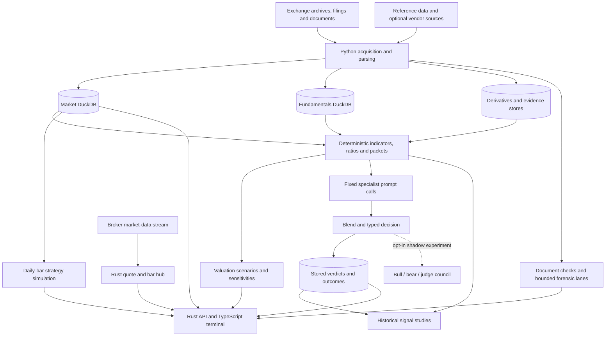

# Athena: architecture review and independent readiness judgment

**Review date:** 12 November 2026, India time. **Baseline:** local checkout `37f1fc1` (9 November), including the existing local data and result artifacts. Three specialist reviewers examined numerical research, agent behavior, and the terminal/operations/execution boundary; the primary reviewer traced the architecture, inspected Graphify and history, checked public peers and consolidated the evidence. These were AI code reviews, not independent human financial-domain validation.

## 1. Judgment

**Athena is a substantial personal research workstation with an experimental AI interpretation layer. A prepared demo is justified. Supervised research use is plausible and useful. Reliable trading decisions or real-account execution readiness are not established.**

The strongest achievement is the infrastructure around the models: exchange-derived financial data, corporate-action and ticker-history handling, deterministic analytics, a live terminal, explicit missing-data behavior, documentary checks, and experiments that report disappointing results. The weakest claim would be that this infrastructure makes the resulting opinions verified, historically unbiased, or profitable. Several concrete defects break those implications.

| Intended use | Judgment | Reason |
|---|---|---|
| Portfolio/project demonstration | **Conditional yes** | Show a frozen build, seeded data, stored/fake outputs and the actual implemented routes. A live agent demo is currently constrained by unavailable credentials. |
| Personal financial research and filing inspection | **Useful under supervision** | Deterministic tables, source links, model assumptions and document differences can save work. An analyst must check material claims and source dates. |
| Professional analyst workflow | **Pilot, not dependable daily adoption yet** | Needs repeatable saved cases/exports, source-vintage guarantees, freshness, reproducible traces and human-reviewed task evaluation. |
| Exploring deterministic strategies | **Yes, with explicitly limited simulation assumptions** | Next-open entries and cost handling are useful. Current studies and bar simulations do not establish portfolio capacity or executable fills. |
| Trader using screens/charts as supporting information | **Limited supervised use** | Historical/educational analysis is reasonable; quote freshness and mixed-generation data need attention. It should not be the only data/risk source. |
| Autonomous investment decisions or reliable live execution | **No readiness claim supported** | No demonstrated agent edge; timing/cohort problems in evaluation; a reproduced kill-switch race; live daily-loss limits are not enforced. |
| Public or multi-user hosted product | **Outside the current deployment contract** | It is intentionally a localhost, single-user system. Hosting it publicly requires a different authentication, isolation and concurrency boundary. |

This is not a blanket rejection of the project. Research assistance and trading alpha are different products. Athena can be valuable at finding and explaining evidence even if its BUY/SELL opinions never beat a simple rule.

## 2. What was reviewed, and how strong the evidence is

The baseline inventory contains **334 Python source files / 39,653 lines**, **35 Rust source files / 9,075 lines**, **128 TypeScript source files / 21,129 lines**, and **253 Python test files / 27,960 lines**. These are raw file/line counts, not a quality score. This audit's guard/test additions are outside those baseline counts.

The review inventoried the whole repository and followed representative production routes end to end. It deeply inspected the high-consequence boundaries described below; it did not execute every branch or formally prove every function. Findings distinguish source-verified behavior, synthetic reproductions, historical local study artifacts, and untested operational expectations.

Graphify contains **13,327 nodes, 37,193 links and three hyperedges**, built at `ffa0541`, one commit before the baseline. Of its nodes, 10,833 are code and the rest rationale/document/concept nodes; 3,911 links are marked inferred. It is valuable for navigation and connections between plans and implementation. Its graph is undirected and includes documentation references, so it is **not** a runtime call trace, execution proof or dependency DAG. The last baseline commit is a data-fetch documentation update; source checks, rather than graph labels, determine the findings.

A separate Python AST import inventory found 1,081 internal import relationships, including local and type-only imports. Shared contracts have 126 importing modules; warehouse, calendar, clock and fundamentals storage are central. High fan-out concentrates in CLI/service/build composition modules. That is generally a sensible dependency shape: domain logic is modular and assembly code connects it. Changes to contracts/storage still have a wide blast radius.

No live LLM call, real broker action or secret environment-file inspection was performed. Public repository reads were used for peer comparisons. Database queries were read-only. Existing untracked `CLAUDE.md`, `examples/` and `r.txt` were preserved. Application defects were reviewed rather than silently repaired; the only implementation work requested during the audit was the environment-access guard.

## 3. The architecture that actually exists

### The data and computation foundation

Python owns acquisition, financial libraries and most analysis. DuckDB holds analytical tables in local files. Rust owns the long-running HTTP/WebSocket server, quote subscriptions and bar hub. TypeScript owns the interactive terminal. Warm Python helpers answer deterministic page requests, while separate workers/jobs handle heavier analysis and document work. The older Streamlit dashboard remains another client.

This split is reasonable for one user. Python is convenient for financial data and TA-Lib; a persistent server avoids Streamlit reruns for tick-driven panels; TypeScript fits browser charts and docked views. Rust does not automatically make the numerical analysis correct, and three languages increase the number of cross-boundary contracts to maintain. A rewrite into one language would currently cost more than it solves.

DuckDB is also reasonable here: the workload is analytical, local and mostly read-heavy. Multiple processes must coordinate writes, hence short write sessions, named job locks, snapshots and helpers. The critical historical-data problem is version storage, not the brand of database. Replacing DuckDB with PostgreSQL without changing the statement schema would preserve that problem.

### Ordinary stock analysis is a controlled workflow, not autonomous learning

`InstrumentResolver` resolves names/tickers/ISINs and returns ambiguity instead of guessing. Asset routing selects specialists. Packet builders compute numerical evidence first; specialists declare required inputs and can abstain without a model call when critical data is absent. The shared wrapper asks for structured output, checks coverage/schema/numeric consistency and retries or rejects invalid replies.

The ordinary orchestrator runs those specialist calls **sequentially**, blends their signals, reports missing participants and applies optional risk/price gates. They normally share the same routed provider tier. A valuation persona and earnings persona are separate analytical instructions, not independent trained models or independent evidence sources.

The main equity route uses valuation, moat/quality, earnings, technicals and news. Flow/ownership specialist definitions and other analytical capabilities exist, but they are not all wired into that same route. ETF routing includes a specialist that is not built. The README's six-specialist description is broader than the default runtime path.

`VerdictRunner` adds saved calibration, typed decisions, optional shadow council and storage. The basic CLI orchestrator path and stored-verdict path are related but not identical. Council results stay beside the blend and do not automatically replace it. This is a good experimental boundary. Its judge is constrained to at most one rating step and cannot raise conviction; those constraints reduce the influence of persuasive unsupported prose but do not prove the prose true.

The displayed confidence is mainly model self-assessment, coverage weighting and later damping. It is **not** a calibrated probability that the investment will succeed. A 70-confidence answer does not mean a demonstrated 70% win probability.

### Forensic work is a different agent architecture

The November forensic layer is closer to a genuine agent system. A lane can choose bounded actions: call an allowed tool, write an entry, leave a note, or finish. Tools calculate in code and save results under evidence IDs. The supervisor routes questions, enforces step/call limits, records rejection reasons and computes concern status. A generated narrative cannot change the deterministic score.

There are two important surfaces:

- The terminal IPO **Analyse** button currently runs the deterministic checks lane with **zero model calls**. It reconciles a document; it is not a live demonstration of every forensic agent.
- `forensic.assemble --agent` can run model lanes. DRHP work assembles checks/text/peers; listed-company work assembles statements/ownership/market. Plumbing and scripted-model tests exist; quality of these newly added model investigations is not established by those tests.

Keeping these surfaces separate is sensible. Demonstrating code-owned totals and page references is already useful. Calling the checks-only panel a complete multi-agent investigation would overstate it.

### Strategy tests, opinion scores and execution are separate systems

The daily strategy engine makes a decision after a close and fills at the next open. It is long-only and single-position, uses fractional shares and simplified costs, handles gap-through stops conservatively and supports user rules. It is a valid exploratory scope.

The factor walk-forward study asks whether indicators rank later returns. The opinion scorecard asks whether LLM signals align with later outcomes. Valuation calibration asks how an assumption-driven model behaves against later prices. None of those, by itself, maintains an executable portfolio with cash, constraints and actual fills.

Separately, the Python broker desk has paper mode and live adapters. It uses pinned limits, keyed audit records, one-use confirmation and typed human confirmation. The Rust market-data terminal has no order endpoint. Therefore “the terminal reads prices” and “the repository includes real-order capability” are both true; “the entire project cannot place orders” is false.

## 4. Why and when the major choices appeared

These reasons come from Git history and design records, not guesses about the author's intentions. Old prose sometimes describes an earlier implementation; current owning code takes precedence.

| Period | What changed | Documented reason / practical consequence |
|---|---|---|
| 4–6 October | Contracts, freshness/coverage, resolver, adapters, deterministic metrics, specialist wrapper and small backtest engine | Establish shared data contracts and keep acquisition/arithmetic outside model personas. Avoid a heavy RL stack for a small rules-based research engine. |
| 10–13 October | Trusted actions/renames, archival/PIT evaluation, warehouse, stored verdicts, technical/fundamental tests and Kronos experiment | Replace guessed price adjustment, reduce data leakage and compare proposed signals with base rates. Kronos was kept out of verdicts after the recorded study did not establish an advantage. |
| 14–19 October | Rust/TypeScript terminal, charts, fundamentals, indicators, formula/replay and derivatives | A tick-driven docked workspace needed a persistent service rather than full Streamlit reruns. The product expanded from analysis calls into a workstation. |
| 22–25 October | DCF/excess-return models, industry references, scenarios, calibration and forward ledger | Turn a valuation opinion into explicit assumptions, ranges and sensitivity. Workbook agreement checks the formula implementation; it does not validate growth or discount-rate assumptions. |
| 24–29 October | Shadow council, usage/cache/fallback work, broker desk and gates, supervisor, snapshots | Investigate whether debate adds value; handle unreliable providers; make operation less manual and coordinate file-backed stores. |
| 3–9 November | Forensic action loop, code-owned proof, document comparisons, checks-only IPO job, later ownership/market/peer lanes | Shift toward inspectable documentary evidence and bounded investigations. The newest lanes have much less live-behavior evidence than the mature deterministic infrastructure. |

The architecture shows deliberate iteration. It also shows breadth growing faster than validation. New product surfaces reuse useful components but have different date, confidence, error and job semantics. The next phase should consolidate those contracts before expanding the number of agents or asset classes.

## 5. Findings that most affect the judgment

Severity is contextual: “high for historical evaluation” does not mean the same issue compromises every current-day screen. Full mechanisms and exact line references are in the component reports.

| ID | Severity and issue | Concrete evidence / trigger | Consequence and recommended repair |
|---|---|---|---|
| Q1 | **High: returns can precede the verdict** | `verdicts/decisions.py:104` starts at `data_as_of`, not creation/executable time. Synthetic Jan 7 verdict received a Jan 1–6 +50% score. Actual stored verdicts have input-date lags up to three calendar days. | Separate evidence time, decision time and eligible fill. Score prospective decisions from a predeclared executable next session. |
| Q3 | **High for replay: revisions erase original statement lines** | `fundamentals/store.py:150` replaces same-key rows. Saving 100 filed in 2024 then 120 filed in 2025 makes a 2024 `AsOfFundamentals` read return empty. | Store immutable filing versions; derive latest and historical views. A date filter cannot recover a deleted original. |
| A1 | **High: grounding checks numbers, not the claim** | `evaluation/grounding.py:29–62` matches against a bag of packet numbers. Negative ROE -0.25 supports the false probe “positive 25%”; P/E 20 supports an unrelated revenue-growth statement. | Bind claims to metric/entity/period/unit/sign; render numbers in code; separately evaluate semantic support. |
| A2 | **High: forensic prose can pass with irrelevant evidence** | `forensic/verify.py:161–195` permits optional quotes/values. An observation about collapsed revenue passed against a board-meeting-only result. | Proposition-level support and source identity; reserve strongest status for code-owned proof or reviewed evidence. Different lane/result IDs are not independent sources. |
| A3/Q2 | **High for historical claims: availability gates are inconsistent** | Forensic text ignores document publication date; ownership admits unknown filing dates; Yahoo uses assumed filing deadlines, which admit a genuinely late filer too early. | One strict publication/availability policy. Label approximate studies separately and abstain when archival availability is unknown. |
| T1 | **High for execution: kill and confirm race** | `brokers/desk.py:100–168`: confirmation locks, kill does not. A paper-only interleaving filled an order after kill returned. | Serialize send/cancel/reconciliation, recheck kill at send, and define in-flight/unknown order handling. |
| T2 | **High for execution: daily loss is not enforced live** | `brokers/safety.py:97–102` marks live daily-loss finding passed while explaining it is unmeasured. | Implement reconciled loss accounting or refuse required-but-unavailable protection. Use unavailable rather than passed. |
| A6/T5 | **Medium: fresh-looking output can use old inputs** | Verdict runner checks packet existence without age gate; Rust snapshot fallback omits generation/provenance. Local price data stopped November 6 at review. | Calendar-aware freshness by dataset; propagate snapshot generation, fallback reason and data date to every output. |
| Q4/Q5 | **Medium/high methodology limits: historical cohort/input approximations** | Calibration uses current shares/reference context and future-event exclusions; factor study drops names missing end prices. | Dated universe/shares/references, terminal-event treatment and fresh locked evaluation. Disclose exploratory associations rather than investable returns. |
| T3 | **Medium: options chain freshness is aggregate** | One fresh contract can make the chain badge live while older contracts/forward still feed IV/Greeks. | Per-input receipt/book/trade times, spread and synchronisation quality; withhold or label invalid combinations. |
| A4/A5 | **Medium: council and budget guarantees are weaker than their names** | Empty council citation lists pass; null types can fail validation unexpectedly. One malformed usage-log line resets the observed monthly count to zero. | Typed nonempty claim references; atomic budget reservations and per-attempt logs; handle corrupt rows explicitly. |
| Q6/T4/T6/T7 | **Medium: discrete correctness/operation defects** | Tied PIT repeat votes divide by zero; supervisor timeout releases locks before confirmed exit; queue wait is outside response timeout; startup ignores native build exit codes. | Shared aggregation; terminate/wait/kill/wait; bounded job queue with total deadline; fail startup on unsuccessful builds. |

Two distinctions matter. First, the separate archival `pit.statements` implementation has real filing-time filtering and should not be blamed for the latest-line-table defect. Second, forensic code-authored accounting relations are stronger than model-chosen relations: that protection is genuinely implemented. The review is identifying holes between these local protections, not claiming no protections exist.

## 6. Code quality and maintainability

**Structure is generally good; consistency across surfaces is the main debt.** Most Python domain modules are modest in size, use explicit data structures, separate pure arithmetic from I/O, and have focused tests. Contracts, calendars, source adapters and specialist wrappers are reusable. Renames, unexplained price breaks, banking/insurer layouts and missing-data handling demonstrate attention to domain-specific failure cases.

The risks concentrate at orchestration boundaries:

- `terminal/src/server.rs` is roughly 1,450 lines and chart-lab view about 1,370. Route/job/UI responsibilities are accumulating in central files. Extract cohesive routers/controllers when touching those areas; line count alone does not justify a wholesale rewrite.
- CLI, Streamlit, stored verdicts and terminal workers expose overlapping analysis with different calibration, council, risk and timeout behavior. Maintain a route/capability contract and a few meaningful cross-surface contract tests.
- Multiple Python launch/job patterns independently implement startup, timeout, error redaction and polling. One bounded subprocess protocol with job IDs and retained diagnostics would reduce drift more than introducing another workflow framework.
- Python dependencies have broad lower bounds and no committed environment lock; Rust/npm do have locks. There is no repository CI workflow; `scripts/check_all.py` is a manual gate and excludes browser E2E. Reproducible installation and mandatory checks matter before sharing the demo widely.
- Historical specs and the README contain drift: no-order claims, universally enforced PIT/freshness, specialist count and peer descriptions. Treat the TRD as history plus intent, and create a small current-runtime contract generated or checked against source.
- Strong unit/golden tests establish arithmetic and protocol behavior. They do not measure source extraction completeness, factual entailment, live operational reliability or investment value. Add tests for those missing properties, not more tests that merely mirror the implementation.

The security boundary is appropriate to localhost in several respects: loopback bind; Host/Origin/fetch-site checks; mostly text-node DOM rendering; constrained model tool allowlists; protected live confirmations; and unresolved-send handling to avoid blind duplicate orders. Trusted custom Python indicators deliberately remain unsandboxed, despite isolated environment/hash enablement. That is an acceptable disclosed owner-only boundary, not permission to run untrusted indicator code safely.

## 7. What the existing results actually show

The read-only snapshot contained **7,719,549 price bars**, spanning 4 January 2010 through **6 November 2026** across 5,097 historical symbols. The current universe had 3,454 rows including equities, SME and ETFs. The fundamentals store had 2,613 companies and about 1.64 million latest-version statement lines. These are substantial collection results; counts do not guarantee completeness or correctness for every security/period.

Only **15 stored verdicts** existed, created October 11–29. Historical PIT logs are larger, but do not substitute for a clean prospective operational record. The latest nightly-build report was November 7, with price data through November 6. This demonstrates the need for a pre-demo freshness check; it does not by itself prove the supervisor is broken today.

The saved 63-day opinion scorecard reports:

| Specialist | Cases / dates | Mean rank IC | Naive t-statistic |
|---|---:|---:|---:|
| Earnings | 612 / 24 | +0.0304 | 0.71 |
| Moat/quality | 740 / 26 | -0.0068 | -0.12 |
| Technical | 1,269 / 37 | +0.0081 | 0.22 |
| Valuation | 669 / 26 | -0.0235 | -0.47 |

IC measures whether stronger signals tend to rank stocks with stronger later returns. Zero means no ranking relationship; a small positive number can matter only if stable and executable. These particular rows do not establish skill. Dates and overlapping horizons share shocks, so hundreds of company cases do not mean hundreds of independent experiments. Some longer-horizon rows disagree between rank and directional-spread metrics; that is a reason to investigate rather than select the flattering metric.

The saved deterministic momentum study is more promising: mean IC about +0.060 over 184 dates and roughly +1.98% average top-fifth excess after its generic costs. However, the comparison is against a cross-sectional median, the study drops missing terminal prices and it does not maintain a filled portfolio. That figure is **not an annual return, live P&L, or evidence of LLM skill**. It is a candidate worth testing properly.

The valuation model can reproduce a workbook accurately while its predicted range remains economically uncertain. Discounted cash flow is the present value of assumed future cash flows; a small change in durable growth, reinvestment or discount rate can change the terminal value substantially. Ranges and reverse-implied assumptions are therefore more useful research outputs than presenting the base number as a correct target.

The current code/version should be attached to historical artifacts. An older saved report's prose may not reflect improvements in today's scoring logic. Do not retrospectively imply an old result was generated by the new code.

## 8. Peer comparison and the improvements worth borrowing

Four current public projects were checked. The detailed [peer comparison](peer-comparison.md) identifies inspected commits/files and sources, including limitations of each comparison. No peer was run head to head, and no public return claim was accepted as proof of readiness.

| Peer | Improvement most relevant to Athena | What Athena should preserve |
|---|---|---|
| TradingAgents | Parallel isolated readers, forced wrap-up, explicit post-analysis entry timing | Direct NSE evidence, deterministic document checks, shadow rather than automatically promoted council |
| Trading-R1 | Immutable result provenance, tool inputs by evidence reference, recoverable omitted context | Task-specific code-owned accounting proof and narrow tool permissions |
| ai-hedge-fund v2 | Shared historical/paper session transition, reconciled cash/positions, decision/fill separation | The integrated India-focused research terminal and filing coverage |
| Qlib | Experiment manifests, richer exchange/portfolio simulation, liquidity/suspension handling | A lightweight single-user workflow; avoid a training/platform migration without a research need |

These are source-based design comparisons, not claims that peers are universally better. See [TradingAgents setup](https://github.com/TauricResearch/TradingAgents/blob/9fa1196fffbcfd9de5146d2dd2869df84ab99838/tradingagents/graph/setup.py), [Trading-R1 evidence](https://github.com/TauricResearch/Trading-R1/blob/b50c941c5833e6c46f36ee1b2277513725ee5367/trading_r1/runtime/evidence.py), [ai-hedge-fund session engine](https://github.com/virattt/ai-hedge-fund/blob/5c553b5222044f6a5527bd377b4104c50ee0ad28/hedge_fund/pipeline/session.py) and [Qlib exchange](https://github.com/microsoft/qlib/blob/main/qlib/backtest/exchange.py).

## 9. Approaches that are currently poor bets, and why

**Adding more personas before an ablation.** Their errors are correlated when they read the same packet through the same model family. More debate can produce a more convincing version of the same mistake and raises latency/cost. Compare rules only, one reader, current specialists and council on identical locked cases first.

**Trying to prove semantic truth with a larger numeric regex.** A number occurring somewhere in a packet cannot tell whether it describes revenue, debt, another company or the wrong period. Use typed factual claims and provenance; evaluate interpretation separately.

**Calling a filtered latest-value store historical truth.** Once the original filing value is replaced, no query predicate can reconstruct it. Preserve versions first. Likewise, a filing deadline is not the publication date of a late report.

**Selecting prompts/strategies on the observed study and then calling it a holdout.** Each decision influenced by those outcomes consumes information. Freeze changes, record variants and use later or genuinely untouched cases. Clustering by time and handling overlapping outcomes matter more than multiplying nominal company rows.

**Treating confidence, a profitable backtest or successful unit tests as market validation.** These measure different things. A correct formula can have wrong assumptions; a valid historical signal can be untradeable after spreads/circuits; a grounded narrative can omit the material risk.

**Introducing RL, a larger time-series model or distributed infrastructure to appear advanced.** The current bottlenecks are evidence/date contracts, evaluation and operations. More model capacity does not fix those. Consider simple learned models only after a clean data/label protocol exists; a blanket claim that ML can never work here would also be unjustified.

**Expanding asset classes or building live automation immediately.** Every added product needs appropriate accounting, market conventions, data histories and evaluation. A dependable research desk for one market is a stronger deliverable than nominally supporting many instruments.

## 10. An ordered improvement plan with acceptance criteria

### Before the next demo

1. Freeze the build and seed known cases; label stored, synthetic and current data consistently. Show the actual source commit and data dates. Launch without background model work or credential-dependent routes.
2. Correct capability descriptions: separate ordinary blend, shadow council, checks-only IPO analysis, opt-in forensic agents and gated broker CLI. Present live model execution as unavailable while credentials are exhausted.
3. Make startup fail on build errors and provide a small preflight: required files, schema compatibility, source coverage, stale data and cached cases. A screenshot of an old successful run must not appear to be today's computation.
4. Use a short scripted demonstration: resolve one stock; inspect statements and a missing-data case; inspect valuation sensitivities; run a deterministic strategy; open a document check with a source page; show the stored AI reasoning and its limitations.

**Acceptance:** a fresh checkout plus a documented sample-data bundle reproduces the demonstration without a paid model, broker login or live exchange dependency. This is a proposed gate; it has not been achieved by this audit.

### Before relying on research scores

5. Repair Q1/Q2/Q3/A3: decision/execution chronology, immutable vintages and strict publication gates. Add adversarial late-filer/revision/future-document tests.
6. Freeze the historical universe and terminal-event treatment. Separate factor association, decision outcomes and portfolio P&L. Address tied-vote scoring and terminal-position accounting.
7. Save one run envelope everywhere: code commit, source hashes/vintages, parser/mapping versions, prompts/schema, exact responding provider/model, cache origin, attempts, costs, input cutoff and output time.

**Acceptance:** deliberate future/revised inputs cannot affect an earlier strict case; prospective returns begin after a decision is actionable; rerunning the same frozen input produces the same deterministic tables and attributable model traces.

### Before calling the AI an effective analyst assistant

8. Add proposition-level evidence references, mandatory citation contracts and truthful verification labels. Retain code-owned invariants.
9. Create a small human-reviewed case set stratified by sector/layout/document quality and failure type. Measure retrieval recall, supported claims, missed material facts, false flags, abstention and review time. Include irrelevant exact quotes, sign/unit errors, contradictory filings and malicious source instructions.
10. Run the rules/one-reader/specialists/council/forensic ablation with the same evidence and budget. Do not tune on the final evaluation cases. Record actual provider attempts, wall time and useful findings per unit cost.
11. Add saved-case export and a reviewer correction mechanism that preserves the original model output rather than overwriting history.

**Acceptance:** an analyst can verify a report faster than assembling it manually, at an agreed error/omission rate, and the extra agents show incremental benefit. Define the numerical thresholds with a domain reviewer before scoring; this audit does not invent an unsupported accuracy target.

### Before any execution-readiness claim

12. Resolve kill/send synchronization and unavailable loss limits. Define the complete order-state machine, including partial fills, cancellation races, network timeouts and uncertain acknowledgments.
13. Reconcile accounts/positions/fills and calibrate costs against real evidence under a separately authorised controlled programme. Validate quote quality per input, capacity, market hours/holidays and price limits.
14. Share portfolio transition/accounting logic between historical and paper modes, then demonstrate restart/disconnect/recovery invariants over extended market sessions. This audit did not connect an account or authorise a live trade.

**Acceptance:** a trustworthy ledger, no blind duplicate sends, known in-flight status when kill completes, and each advertised limit either enforced or visibly unavailable/refused. Profitability remains a separate statistical question even after those engineering gates pass.

## 11. Verification and limitations

Verified test results, environment limitations and commands are recorded in [verification.md](verification.md). The scoped broad Python run passed **2,555 tests**, with 74 live tests skipped and nine modules explicitly excluded; the final guard run passed **22 tests**. The web suite passed **895 tests** and the production build passed. Rust compiled, but sandbox socket restrictions prevented a clean all-tests result. Streamlit AppTest cases were among the exclusions after temporary-directory failures/noncompletion; these are not an unqualified full-suite pass.

No live model quality, market-hours latency, real account reconciliation, contract-note costs, long-running soak, clean-machine installation, browser E2E, accessibility audit or package vulnerability audit was established. These are untested areas, not an assertion that each is defective.

## 12. Deliverables and guard requested during the review

- [Agent reasoning and evidence review](agent-review.md): six findings, actual agent routes and reproducible false-claim/date probes.
- [Quant/data/backtesting review](quant-review.md): seven findings, offline reproductions, local study values and strict-versus-approximate history distinctions.
- [Terminal/operations/broker review](terminal-review.md): eight findings, paper kill-switch reproduction, UI/build checks and runtime history.
- [Four-project peer comparison](peer-comparison.md): direct owning-source links and selective adoption advice.
- [Verification record](verification.md): exact scope and limits; overlapping focused test counts are not added together.
- `scripts/block_env_access.py`, `tests/test_env_access_hook.py`, and root `AGENTS.md`: the requested environment-access guard and assistant policy; see [guard setup and limits](env-guard.md). The local ignored `.claude/settings.json` registers the hook. It covers common Claude Code file/search/shell tools, including template files; Codex obeys the repository instructions. It is not an OS sandbox and cannot intercept every arbitrary program or computed-path bypass. No environment file was changed.

The independent recommendation is to make the next milestone **a reproducible, evidence-first Indian analyst desk**. Its success should be measured by trustworthy source reconstruction and time saved for a reviewer. Preserve the multi-agent experiments, but require them to earn their complexity through measured benefit.
